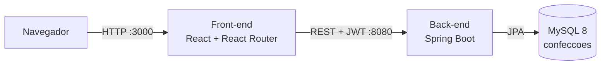

<p align="center">
  
</p>

<h1 align="center">TRAMA</h1>

<p align="center">
  Painel de inteligência de dados para as confecções do Polo Têxtil do Agreste pernambucano.
</p>

<p align="center">
  <a href="https://github.com/AstralCommits/TRAMA/actions/workflows/backend.yml"></a>
  <a href="https://github.com/AstralCommits/TRAMA/actions/workflows/frontend.yml"></a>
  <a href="https://github.com/AstralCommits/TRAMA/actions/workflows/database.yml"></a>
</p>

---

## Sumário

- [Sobre o projeto](#sobre-o-projeto)
- [Funcionalidades](#funcionalidades)
- [Arquitetura](#arquitetura)
- [Tecnologias](#tecnologias)
- [Estrutura do repositório](#estrutura-do-repositório)
- [Como rodar](#como-rodar)
- [Documentação](#documentação)
- [Como contribuir](#como-contribuir)
- [Equipe](#equipe)

## Sobre o projeto

O TRAMA reúne as vendas das confecções do Polo Têxtil do Agreste (Caruaru, Toritama e Santa Cruz do Capibaribe), mostra as tendências por categoria e simula o impacto da concorrência, para apoiar a decisão sobre o que produzir.

Projeto Integrador do curso de Análise e Desenvolvimento de Sistemas do Senac Recife, desenvolvido pela equipe AstralCommits.

## Funcionalidades

- **Indicadores de vendas:** faturamento, peças vendidas e categoria líder, com filtros por mês, ano e cidade.
- **Tendências por categoria:** compara cada período com o anterior e marca alta, queda ou estabilidade.
- **Simulador de concorrência:** mostra o faturamento de uma categoria com um percentual de impacto da concorrência, de 0 a 100%, e guarda os cenários.
- **Importação de CSV:** carrega as vendas do mês de uma vez, validando cada linha numa transação única.
- **Cadastros:** categorias, confecções e lançamentos mensais.
- **Perfis de acesso:** administrador e empresário, e cada empresário só vê os dados da própria confecção.
- **Auditoria:** o banco registra toda alteração e exclusão de lançamento.
- **Demonstração:** a Confecção Fio do Agreste já vem com dados fictícios para conhecer o sistema.

## Arquitetura



O front conversa com a API por REST, com um token JWT. A API é a única parte que acessa o banco. Com a demonstração ou com uma conta criada só no navegador, o front funciona sem a API e guarda os dados localmente.

## Tecnologias

| Parte | Tecnologias |
|---|---|
| Front-end | React 19, React Router 8, Vite 8, Tailwind CSS, TypeScript, Vitest |
| Back-end | Java 21, Spring Boot 3.3 (Web, Data JPA, Validation, Security), JWT, SpringDoc OpenAPI, JaCoCo |
| Banco de dados | MySQL 8 (procedures, triggers, views), SQLite como alternativa local |
| Infraestrutura | Docker Compose, GitHub Actions, SonarQube (opcional) |

## Estrutura do repositório

```
TRAMA/
├── backend/            API REST em Spring Boot            → backend/README.md
├── frontend/           aplicação web em React             → frontend/README.md
├── database/           scripts MySQL, SQLite e backup     → database/README.md
├── docs/               requisitos, arquitetura, testes, segurança e histórico
├── .github/            CI, CODEOWNERS e modelos de issue e de Pull Request
├── docker-compose.yml  sobe banco, API e front juntos
├── .env.example        senhas e porta do banco para o docker compose
├── CHANGELOG.md        mudanças de cada versão
├── CONTRIBUTING.md     fluxo de trabalho da equipe
├── SECURITY.md         como relatar uma falha de segurança
└── LICENSE             licença MIT
```

Cada pasta tem um README com os detalhes da sua parte.

## Como rodar

### Com Docker (recomendado)

Precisa do [Docker](https://www.docker.com/) com o Compose. Na raiz do repositório:

```bash
docker compose up --build
```

| Serviço | Endereço |
|---|---|
| Front-end | http://localhost:3000 |
| API | http://localhost:8080 |
| Documentação da API (Swagger) | http://localhost:8080/swagger-ui.html |
| MySQL | `localhost:3307`, banco `confeccoes`, usuário `trama` |

O banco sobe com o schema completo e com a massa de demonstração. A API espera o banco ficar pronto, e o front espera a API. Para apagar os dados e começar de novo:

```bash
docker compose down -v
```

As senhas e a porta do banco têm valores padrão para desenvolvimento. Para trocar, crie um arquivo `.env` na raiz a partir do [`.env.example`](.env.example) antes de subir.

Os usuários para entrar no sistema estão no [README do banco](database/README.md#usuários-de-demonstração).

### Sem Docker

| Parte | Requisito | Como rodar |
|---|---|---|
| Banco | MySQL 8 | [database/README.md](database/README.md#como-executar) |
| Back-end | Java 21 | [backend/README.md](backend/README.md#como-rodar) |
| Front-end | Node.js 22.22+ | [frontend/README.md](frontend/README.md#como-rodar) |

O Back-end também roda sozinho, com um banco H2 em memória, e o Front-end roda sozinho no modo demonstração.

## Documentação

A documentação segue as normas ISO/IEC/IEEE adotadas na disciplina e fica em [`docs/`](docs/README.md):

| Norma | Documento |
|---|---|
| ISO/IEC/IEEE 29148 | [Especificação de requisitos](docs/requisitos/especificacao-requisitos-29148.md) |
| ISO/IEC/IEEE 42010 | [Descrição da arquitetura](docs/arquitetura/descricao-arquitetura-42010.md) |
| ISO/IEC/IEEE 26514 | [Guia de instalação e uso](docs/usuario/guia-instalacao-uso-26514.md) |
| ISO/IEC/IEEE 29119 | [Plano de testes](docs/testes/plano-testes-29119.md) |
| ISO/IEC 12207 | [Ciclo de vida](docs/processo/ciclo-de-vida-12207.md) |
| ISO/IEC 27001 | [Segurança da informação](docs/seguranca/seguranca-informacao-27001.md) |

Acompanhamento: [auditoria de 09/11](docs/auditoria/2026-11-09-auditoria.md), [cronograma](docs/cronograma/cronograma-2026-11.md) e [roteiro da apresentação](docs/apresentacao/ROTEIRO_APRESENTACAO.md).

## Como contribuir

A `main` é protegida: toda mudança entra por Pull Request, com a aprovação de pelo menos uma pessoa da equipe e o CI passando. O [guia de contribuição](CONTRIBUTING.md) explica o nome das branches, o padrão dos commits (`DB-01:`, `BACK-02:`, `FRONT-04:`) e o que conferir na revisão.

Este repositório junta os antigos [Back-end](https://github.com/AstralCommits/Back-end), [Front-end](https://github.com/AstralCommits/Front-end) e [Banco-de-Dados](https://github.com/AstralCommits/Banco-de-Dados), com o histórico de commits de cada um. As branches que vieram de lá têm o nome do repositório na frente (`back-end/`, `front-end/`, `banco-de-dados/` e `novas-funcionalidades/`) e ficam só como histórico. As tags de versão do banco (`v0.1.0` a `v0.3.1`) continuam no repositório [Banco-de-Dados](https://github.com/AstralCommits/Banco-de-Dados/tags).

## Equipe

| Frente | Integrantes |
|---|---|
| Front-end | Maria Nicolle, Júlio Cesar Braga e Gyovanna Gabrielly |
| Back-end | Ester Reis e Gabriela Olegário |
| Banco de Dados | Jamile Keiller e Júlia Cássia |

Senac Recife, Análise e Desenvolvimento de Sistemas, 2026.
