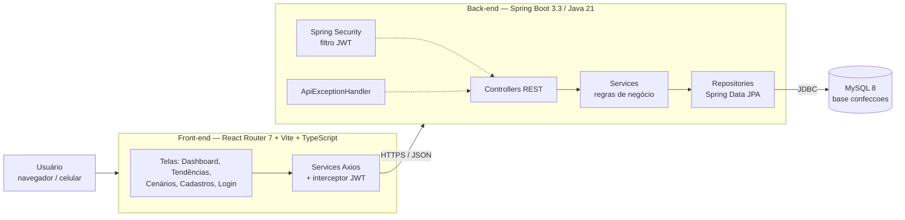
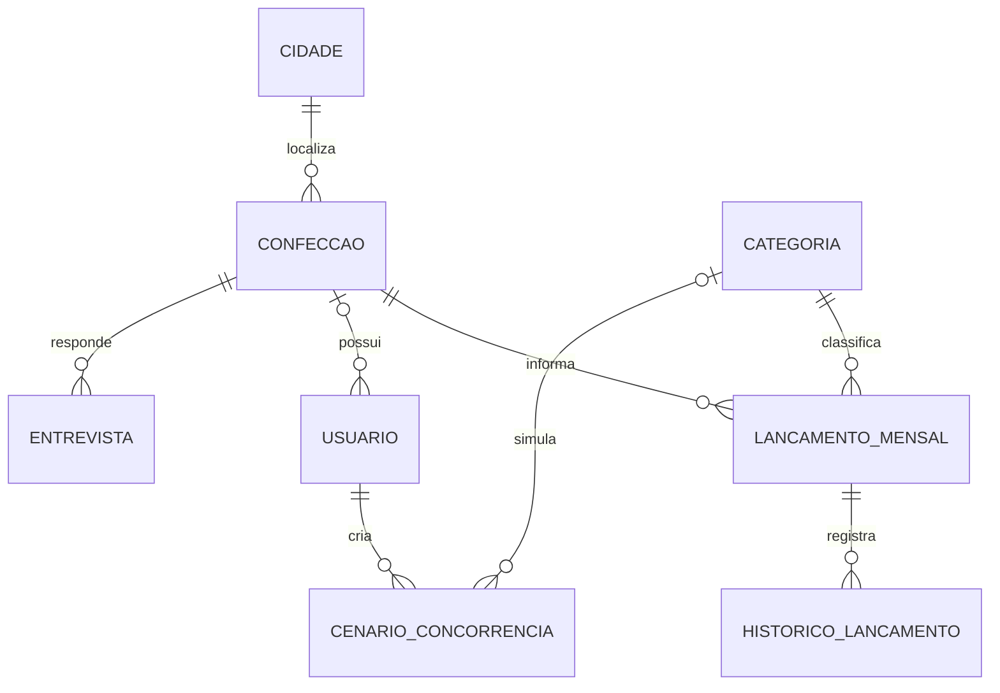
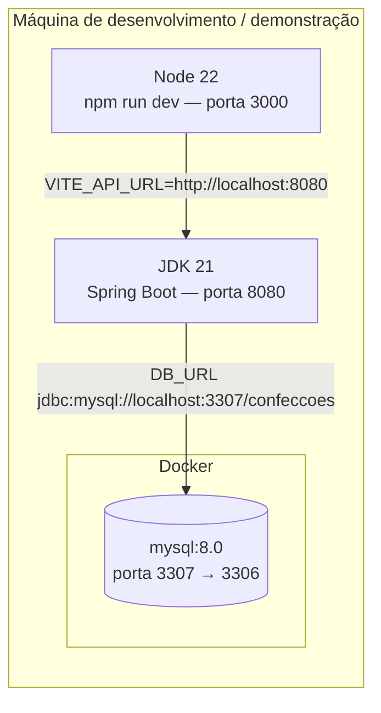

# Descrição de Arquitetura — TRAMA (ISO/IEC/IEEE 42010)

| Campo | Informação |
|---|---|
| Sistema de interesse | TRAMA — plataforma web de indicadores para o Polo Têxtil do Agreste |
| Versão | 1.0 — 09/11/2026 |
| Responsáveis | Banco de Dados: Jamile Keiller, Júlia Cássia · Back-end: Ester Reis, Gabriela Olegário · Front-end: Gyovanna Gabrielly, Maria Nicolle |
| Requisitos de origem | [Especificação de Requisitos v2.0](../requisitos/especificacao-requisitos-29148.md) |

## 1. Stakeholders e preocupações

| Stakeholder | Preocupações (concerns) | Visões que respondem |
|---|---|---|
| Empresário (EMPRESARIO) | Ver números certos, rápido, no celular | Lógica, Implantação |
| Equipe ADMIN | Cadastrar dados com fonte e sem duplicidade | Lógica, Dados |
| Desenvolvedoras (6) | Onde cada coisa fica; como rodar; contratos entre camadas | Desenvolvimento, Dados, Lógica |
| Professores / banca | Integração real, aderência à SRS, rastreabilidade | Todas + seção 6 |
| Entrevistados | Anonimato (LGPD) | Dados, Segurança |

## 2. Pontos de vista adotados

| Ponto de vista (viewpoint) | Pergunta que responde | Modelo usado |
|---|---|---|
| Lógico | Quais componentes existem e como conversam? | Diagrama de componentes |
| Dados | Como os dados são guardados e quais regras o banco garante? | Modelo entidade-relacionamento |
| Implantação | Onde cada parte roda? | Diagrama de implantação |
| Desenvolvimento | Como o código e os repositórios se organizam? | Tabela de repositórios e pacotes |

## 3. Visão lógica



| Componente | Responsabilidade | Requisitos |
|---|---|---|
| Telas React | Exibir dados, validar formulário, mostrar estados vazio/erro | RF01–RF09, RNF04–RNF06 |
| Services Axios | Chamar a API, anexar token, traduzir erros | RF09, RNF10 |
| Controllers | Receber HTTP, validar DTO (Bean Validation) | RNF09, RNF10 |
| Services Java | Duplicidade, tendência (±5%), fórmula do cenário | RF03, RF06, RF07, RNF03 |
| Repositories | Consultas, incluindo agregação de indicadores | RF05, RNF01 |
| Segurança | Login, emissão e validação de JWT, perfis | RF09, RNF07 |
| MySQL | Integridade (FK, UNIQUE, CHECK), triggers de histórico, índices | RF01–RF04, RNF01 |

## 4. Visão de dados



Regras garantidas no banco (independentes da API): cidades limitadas por `CHECK`; categoria única; lançamento único por confecção + categoria + mês; quantidade e faturamento ≥ 0; mês sempre no dia 1; percentual de impacto entre 0 e 100; perfil ADMIN sem confecção e EMPRESARIO com confecção. O modelo completo (11 tabelas, procedures, triggers, índices) está no [repositório Banco-de-Dados](https://github.com/AstralCommits/Banco-de-Dados).

## 5. Visão de implantação



| Perfil da API | Banco | Uso |
|---|---|---|
| `local` (padrão) | H2 em memória, `ddl-auto: update` | Rodar sem Docker; dados somem ao parar |
| `dev` | MySQL do Docker, `ddl-auto: validate` | **Perfil da demonstração**: valida que entidades e schema batem |
| `sqlite` | `extensao.db` | Alternativa local sem MySQL |

## 6. Correspondências e inconsistências conhecidas

A 42010 pede registrar onde as visões não batem. Situação em 09/11:

| ID | Entre | Inconsistência | Estado |
|---|---|---|---|
| COR-01 | Dados × Lógica | `fonte_dado` (BD) × `origem_dado` + `nome_fonte` (entidade) | Resolvido no PR #8 do Banco-de-Dados |
| COR-02 | Lógica (Front × API) | Contrato de `GET /api/indicadores` (parâmetros, nomes de campos, `ESTAVEL` × `ESTÁVEL`, `SEM_BASE`) | Aberto — AUD-04 |
| COR-03 | Implantação | Perfil `dev` em `3306` com `root`; Docker em `3307` com `trama` | Contornado por variáveis `DB_URL`, `DB_USERNAME`, `DB_PASSWORD` |
| COR-04 | Lógica | Front-end autentica em `localStorage`; API usa JWT | Aberto — AUD-05 |

### Contrato acordado de `GET /api/indicadores` (proposta)

```
GET /api/indicadores?inicio=2026-01&fim=2026-03&cidade=Caruaru&categoriaId=2
Authorization: Bearer <token>

200 OK
{
  "inicio": "2026-01", "fim": "2026-03",
  "inicioComparacao": "2025-10", "fimComparacao": "2025-12",
  "cidade": "Caruaru", "categoriaId": 2,
  "totalQuantidade": 1240, "totalFaturamento": 86800.00,
  "indicadores": [
    { "categoriaId": 2, "categoria": "Jeans",
      "quantidadeAtual": 1240, "faturamentoAtual": 86800.00,
      "quantidadeAnterior": 1100, "faturamentoAnterior": 77000.00,
      "variacaoPercentual": 12.7, "tendencia": "ALTA" }
  ],
  "mensagem": null
}
```

`tendencia` ∈ {`ALTA`, `QUEDA`, `ESTAVEL`, `SEM_BASE`}; o Front-end exibe "ESTÁVEL" e "Sem base". Sem dados no período: `indicadores: []` e `mensagem: "Não há dados para o período selecionado"`.

## 7. Decisões de arquitetura

| ID | Decisão | Motivo | Alternativa descartada |
|---|---|---|---|
| ADR-01 | Três repositórios (BD, Back, Front) + `TRAMA` para documentação | Cada frente evolui e é avaliada separadamente | Monorepo |
| ADR-02 | MySQL 8 como banco oficial; SQLite e H2 só para teste local | Exigência do professor; CHECK e triggers do modelo | PostgreSQL |
| ADR-03 | `ddl-auto: validate` no perfil de demonstração | Garante que o schema versionado é o que a API usa | `update` (esconde divergências) |
| ADR-04 | JWT sem estado com perfis ADMIN/EMPRESARIO | SPA separada da API; RF09 | Sessão com cookie |
| ADR-05 | Tendência e cenário calculados no Back-end | Uma única regra testável (RF06, RNF03) | Calcular no Front |
| ADR-06 | Fórmula linear transparente no cenário | RNF03; público com baixa familiaridade digital | Modelo preditivo (fora de escopo) |
